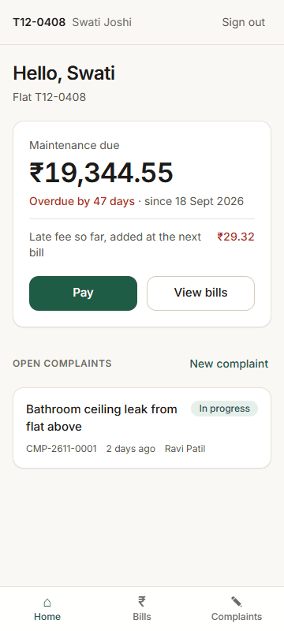
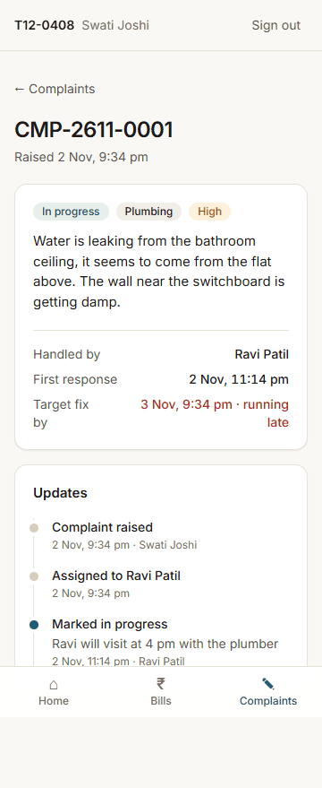
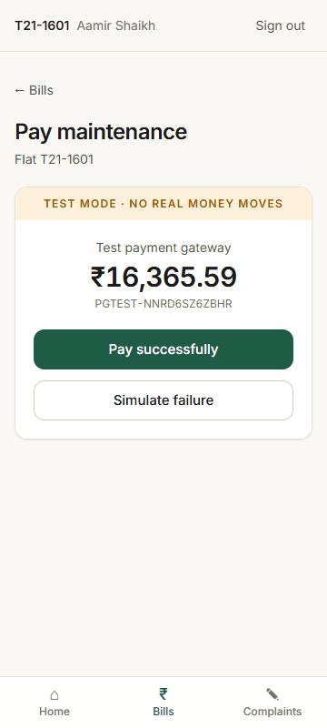
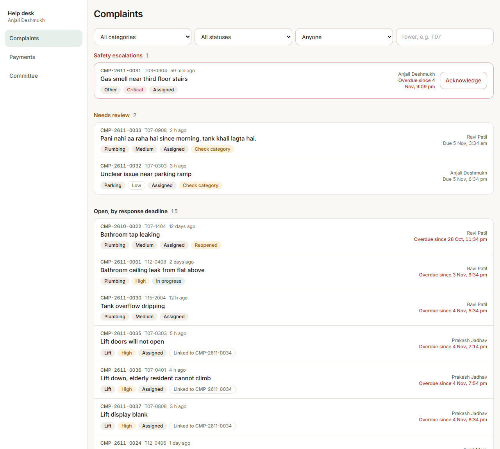
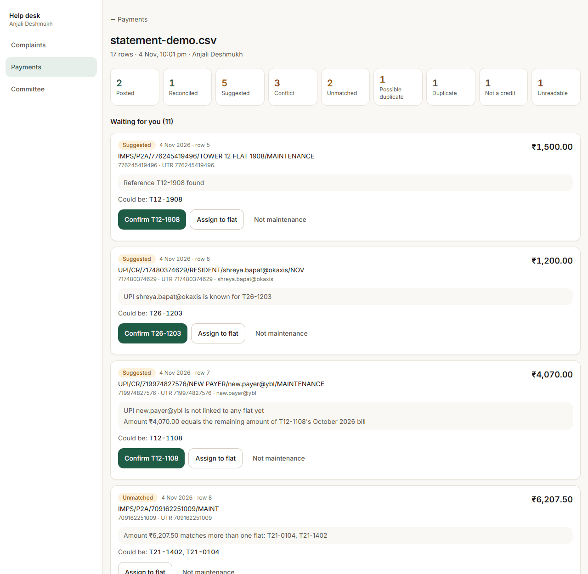
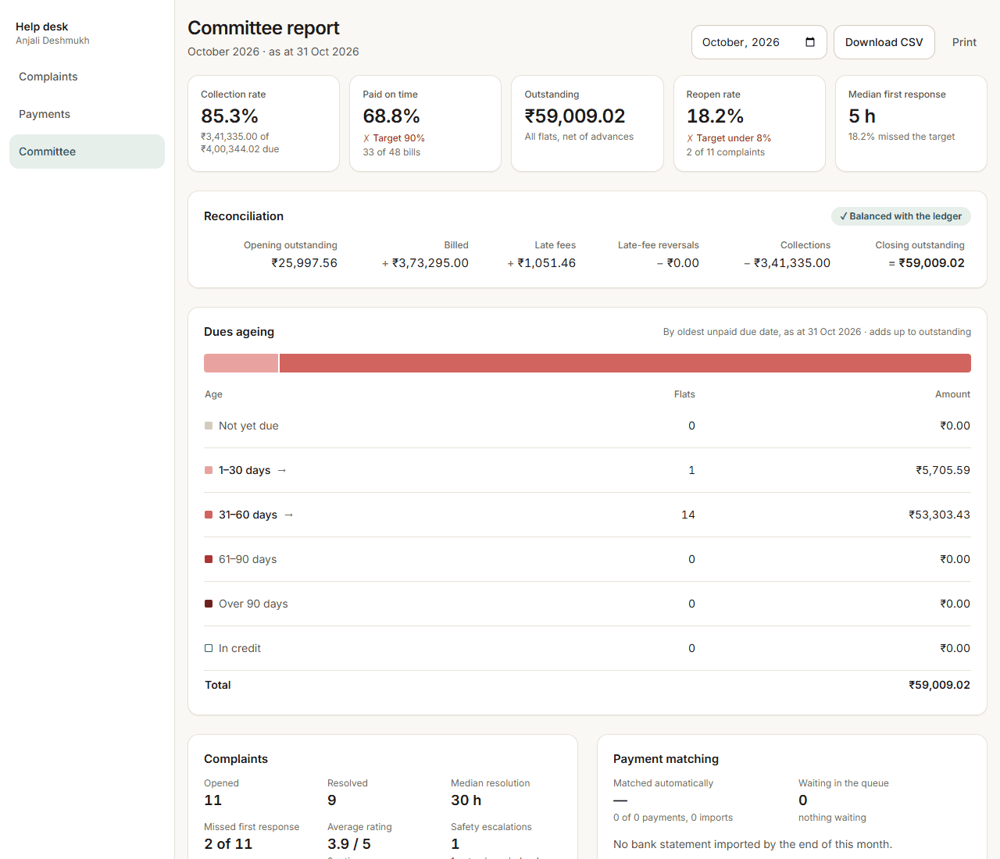

# Township resident app

**Live app: https://isocode-township.onrender.com**  
Hosted on Render’s free tier. If the app has been idle, the first load can take about a minute while the server starts; after that it’s fast.

A resident app for a gated township in Pune: 2,400 flats in 28 towers.

- **Residents** sign in with their phone number and a one-time code, see and pay their flat's maintenance in test mode, raise complaints with a photo, and follow each complaint to closure.
- **The help desk** imports bank statements. Clear payments post themselves; anything unclear waits in an accounts queue for a person to confirm.
- **Complaints** are sorted by AI into a category and an urgency. Safety words always escalate to the duty manager by rule, and the same fault reported by many flats is linked, not closed.
- **The federation committee** gets a monthly report it can trust: collections, a reconciliation that must balance, dues ageing and complaint times.

Built for the Isocode Labs take-home (Brief 4) with Spring Boot 3 (Java 21), PostgreSQL 16, React 18 and Google Gemini.

- **Run it / deploy it / demo logins:** [deployment.md](deployment.md)
- **Five-minute walkthrough:** [docs/DEMO.md](docs/DEMO.md)
- **Technical design:** [docs/TDD.md](docs/TDD.md) (PDF: `docs/TDD.pdf`)
- **Assumptions:** [docs/ASSUMPTIONS.md](docs/ASSUMPTIONS.md) · **Build log:** [docs/PROGRESS.md](docs/PROGRESS.md)

## Screens

| Resident home | Complaint detail | Test payment |
|---|---|---|
|  |  |  |

| Help desk complaint board | Bank import |
|---|---|
|  |  |

| Committee report |
|---|
|  |

## Quick start

```bash
cp .env.example .env            # fill DATABASE_PASSWORD and JWT_SECRET
docker compose up -d db
docker build -t township .
docker run --rm -p 8080:8080 --env-file .env -e DATABASE_URL=jdbc:postgresql://host.docker.internal:5432/township township
```

Open http://localhost:8080. For Windows commands, development mode and tests, see [deployment.md](deployment.md).

## Repository

```
backend/    Spring Boot app, packaged by feature: auth, flat, billing, payment, matching, complaint, ai, committee, common
frontend/   React + Vite + TypeScript + Tailwind
docs/       brief, plan, progress log, assumptions, demo script, TDD
samples/    sample bank statement and the labelled complaint set for the AI evaluation
```
