# Technical Design Document: Township resident app

**Isocode Labs take-home, Brief 4: gated township resident app (Pune, 2,400 flats, 28 towers)**

Author: Maniram · November 2026

- **GitHub:** https://github.com/ManiraM-1/isocode-township
- **Live app:** https://isocode-township.onrender.com (demo mode: sign-in codes are shown on screen; logins in `deployment.md`)
  Hosted on Render’s free tier. If the app has been idle, the first load can take about a minute while the server starts; after that it’s fast.
- **Five-minute walkthrough:** `docs/DEMO.md` in the repository

---

## 1. What was built

The brief's core slice, end to end:

| Core requirement | What exists |
|---|---|
| Resident login | Phone number and one-time code (SMS mocked), session in an httpOnly cookie, roles RESIDENT and HELPDESK |
| Maintenance bills with test payment | Monthly bills (area × rate), daily late interest, statement with running balance, test gateway with success and failure, receipts |
| Bank statement matching (the hard part) | CSV import, a twelve-rule decision table, automatic posting only when two signals agree, an accounts queue for everything else, never double-posting on re-import |
| Complaints with assignment and status | Raise with a photo, auto-assignment to a specialist, response timers, legal status moves only, close with a rating or reopen, duplicates linked across flats |
| AI: category and urgency | Gemini classifies in the background; a safety rule escalates independently of the AI; keyword fallback; a review lane for low confidence |
| Committee view | Monthly collections, reconciliation that must balance, dues ageing with a drill-down, complaint and matching metrics, CSV download |

Eight-plus screens: login, resident home, bills and statement, pay and receipt, complaints (list, new, detail), help desk board and complaint detail, payments (import and queue), committee report.

**Quality bar:** 588 backend tests (JUnit 5, AssertJ, Mockito, Spring Boot tests on real PostgreSQL through Testcontainers) and 24 frontend tests (Vitest). Each of the nine product rules in Section 4 has at least one test. The commit history follows the build plan one step at a time.

---

## 2. Architecture and why

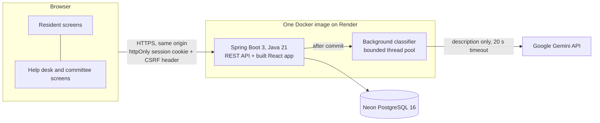

**One deployable, same origin.** Spring Boot serves both the API and the built React app. Because the browser talks to one origin, the session can live in an httpOnly, Secure, SameSite=Lax cookie (not localStorage), with no CORS configuration. A client could run it as one container on any host.

**Spring Boot and PostgreSQL** because this is a money system: transactions, row locks, `NUMERIC(12,2)`, constraints and triggers do much of the safety work. The ledger is append-only through a database trigger, so even a bug in the code cannot edit history. Flyway versions the schema (nine migrations).

**Packaged by feature, not by layer** (`auth`, `flat`, `billing`, `payment`, `matching`, `complaint`, `ai`, `committee`, `common`), so each brief area can be read on its own.

**The decisions live in plain classes with no Spring or database**, so they are tested directly and fast: bill and late-fee calculation (`BillCalculator`, `LateFeeCalculator`), payment allocation (`PaymentAllocator`), the bank CSV parser and the matching decision table (`BankStatementParser`, `PaymentMatcher`), the safety rule (`SafetyRule`), the escalation policy, the complaint state machine, duplicate detection (`DuplicateDetector`), and the committee arithmetic (`DuesAgeing`, `LedgerTotals`, `ComplaintMetrics`). Services wrap them with transactions, locks and auditing.

**React, Vite, TypeScript, Tailwind and TanStack Query** for a fast, typed frontend with caching, loading and error states and background refetching. It needs no state library.

**Gemini over REST** with a strict response schema, a timeout, one retry and a deterministic fallback (Section 7).

**Render + Neon** for a free hosted demo. The trade-off is a cold start of about a minute after idle (`deployment.md`).

---

## 3. Data model

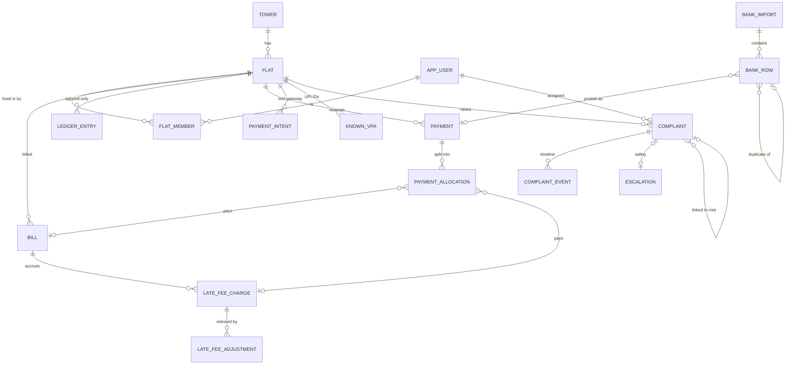

Key points:
- **Money is exact.** `NUMERIC(12,2)` in PostgreSQL and `BigDecimal` (scale 2, HALF_UP) in Java, never `double`. JSON carries money as strings.
- **The ledger is the truth.** `ledger_entry` holds every debit (bill, late fee) and credit (payment, late-fee reversal), one per source (unique `(type, ref_type, ref_id)`). Triggers reject `UPDATE`, `DELETE` and `TRUNCATE` on `ledger_entry`, `payment` and `payment_allocation`. Corrections are new reversing entries.
- **Allocations are dated**, so "paid on time" and "unpaid at the end of the month" can be computed for any past date. This is what makes the committee's ageing and on-time rate exact.
- **Re-import safety lives in the schema too:** a UTR and a gateway reference can each be posted only once (partial unique indexes); every bank row is stored with its decision, reasons, candidates and resolution.
- **Complaints** keep their own event table (the timeline and the audit of every correction), SLA due times, the AI's answer next to the current values, and `parent_id` for duplicate linking (always to the root, so there are no chains).
- `society_settings` holds the configurable numbers (rate per sq ft, due day, interest rate, response targets, AI confidence threshold, auto-post limit). `audit_log` records postings and queue decisions; `outbox_message` holds the mocked SMS.

---

## 4. Product rules and where they are enforced

| Rule from the brief | Enforced by | Test |
|---|---|---|
| Unclear payments are never posted automatically | Decision table: only two agreeing signals post; everything else is queued; a person confirms | Every queued decision type creates no payment |
| Safety words always escalate, whatever the AI says | `SafetyRule` runs before and independently of the AI; the AI can add an escalation but never remove or lower one | AI says LOW for "gas leak": still Critical and escalated; Hindi and Marathi terms |
| Duplicate complaints are linked, never closed | `DuplicateLinker` links to the group's root; status never changes on linking | Linking never changes status; each resident sees "n flats reported this" |
| Help desk changes a category in one tap, recorded | `PATCH /category`, event `CATEGORY_CHANGED` from/to | Correction recorded, review cleared |
| A resident sees and acts only on their own flat | `FlatAccessGuard` on every flat-scoped endpoint, server-side | 403 for every other flat's bills, ledger, receipts, payments, complaints, photos |
| Money is exact | `BigDecimal` / `NUMERIC(12,2)` throughout | Allocation, interest and reconciliation tests to the paisa |
| The ledger is append-only | Database triggers; reversing entries | Update and delete rejected by the database |
| Re-importing a statement never double-posts | UTR and gateway-reference uniqueness, row hashes, `DUPLICATE` and `POSSIBLE_DUPLICATE` | Sample imported twice: second import posts nothing |
| No dead buttons | Features that are not built have no button; demo-only controls exist only in demo mode | Condition tests for demo-only endpoints |

---

## 5. Main flows

### 5.1 Sign-in
Phone number → `POST /api/auth/otp/request`. The 6-digit code comes from `SecureRandom` and is stored only as a BCrypt hash; it expires after 5 minutes. A number may request 3 codes per 10 minutes, and the code locks after 5 wrong tries. Unknown numbers get an identical response, so the endpoint cannot be used to discover residents. `verify` sets a 12-hour JWT in an httpOnly, Secure, SameSite=Lax cookie. Every write carries a CSRF header (double-submit cookie). In demo mode the code is returned and shown on screen.

### 5.2 Billing and late fees
The billing run for a month creates one bill per flat (area × ₹6.50, due on the 10th) and posts the late interest accrued up to the previous month end, so a run depends only on its month and rerunning it never posts twice. Interest is 21% a year, simple, charged per day on the principal still unpaid at the end of that day (a payment stops interest from the day it is made), rounded once per bill per period. The resident sees "late fee so far" live.

### 5.3 Paying (test gateway)
`POST /payment-intents` with an idempotency key per attempt: the same key returns the same intent, and the same key with a different amount is refused. `simulate` SUCCESS posts once, however often it is sent; FAILURE posts nothing. `PaymentPostingService` is the only place money is posted. It locks the flat, allocates oldest bill principal first, then late fees, then advance, and writes the payment, the dated allocations, a ledger credit, a receipt number and an audit entry in one transaction. A payment dated before an interest period that was already charged triggers a reversing late-fee adjustment.

### 5.4 Bank statement import and the accounts queue
Upload (CSV, at most 5 MB and 20,000 rows) → parser (header aliases, Indian number grouping, three date formats, bad rows reported by row number without stopping the file) → matcher → every row stored with its decision and reasons → `AUTO_POSTED` rows posted through the same posting service, all in one transaction. The queue offers **Confirm** (suggested rows), **Assign to flat** (searchable) and **Not maintenance** (a reason is required). Each action locks the row, posts at most once (409 otherwise), records who and when, and learns the UPI ID for next time.

### 5.5 Complaints
Raise (text 10–1,000 characters, optional photo checked by magic bytes and resized in the browser to at most 1,600 px) → the safety rule and the keyword classifier run synchronously → the complaint is saved as "sorting" and auto-assigned to the specialist with the fewest open complaints → after the commit, the AI classifies it in the background (Section 7) → the help desk works the board lanes (Safety, Needs review, Open by deadline, Awaiting resident). Only legal status moves are offered. Resolved complaints are closed by the resident with a 1–5 rating, or reopened with a reason back to the same person. Duplicates are linked on tower, category, time and wording; "apply to linked" moves the whole group and reports anything it had to skip.

### 5.6 Committee report
`GET /api/committee/overview?month=` computes everything from the ledger, as at the month end (or today for the current month):
- **Reconciliation:** opening + billed + late fees − reversals − collections = closing, with a `balanced` check.
- **Dues ageing:** each flat's balance by its oldest unpaid due date, with an "In credit" line, so the buckets add up to the closing outstanding.
- **Rates:** collection rate, on-time rate (target 90%), auto-post share, complaint medians, first-response breaches, reopen rate (target under 8%) and average rating.

A test on the full demo history checks that every month balances and opens where the previous one closed.

---

## 6. Payment matching decision table

Each bank row is reduced to four signals:
- **R**, a flat reference: flat codes in the description or reference, in six written forms such as `T07-1203`, `T7/1203` or `TOWER 7 FLAT 1203`.
- **V**, a UPI ID already known for a flat.
- **A**, an amount that exactly equals a flat's outstanding or one bill's remaining principal.
- **G**, a test-gateway reference.

The amount only ever **supports** R or V: equal bills are common (flats of equal area), so an amount never overrides what the resident wrote and never causes a conflict on its own. Rules apply in this order:

| # | Condition | Decision | Posted? |
|---|---|---|---|
| 1 | UTR or gateway reference already posted, reconciled or earlier in this file | `DUPLICATE` | No, not queued |
| 2 | Not a credit | `NON_CREDIT` | No |
| 3 | Same row hash as an earlier row and no UTR | `POSSIBLE_DUPLICATE` | No, queued (two identical cash deposits can be real) |
| 4 | Gateway reference matches and the amount is equal | `RECONCILED_GATEWAY` | No, already posted online |
| 5 | Gateway reference matches, amount differs | `CONFLICT` | No, queued |
| 6 | Reference ambiguous, or reference and UPI ID name different flats | `CONFLICT` | No, queued |
| 7 | Reference and UPI ID name the same flat | `AUTO_POSTED`, HIGH | **Yes** |
| 8 | One of reference or UPI ID, plus an amount unique to that same flat | `AUTO_POSTED`, HIGH | **Yes** |
| 9 | One of reference or UPI ID only | `SUGGESTED`, MEDIUM | No, one-click confirm |
| 10 | No reference or UPI ID, amount unique to one flat | `SUGGESTED`, MEDIUM | No, one-click confirm |
| 11 | No reference or UPI ID, amount on several flats | `UNMATCHED` with candidates | No |
| 12 | Nothing matches | `UNMATCHED` | No |

Two guards demote an otherwise automatic post to `SUGGESTED`: an amount above the flat's dues plus one month's bill ("₹68,000.00 is much higher than T21-0303's dues of ₹11,610.61; check before posting"), and a transaction dated in the future. Every result carries plain-language reasons, which the queue shows. The engine matches 3,000 rows against 2,400 flats in about 0.5 s. The sample statement in `samples/` and the demo-mode generated statement produce every decision type.

---

## 7. How the AI works, and how it fails safely

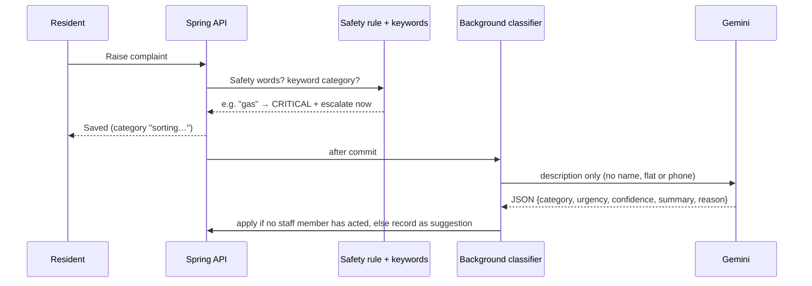

- **The safety rule comes first and stands alone.** It covers configurable whole-word terms in English, Hindi, Marathi and romanised Hinglish (fire, smoke, gas, LPG, short circuit, shock, lift stuck, आग, गॅस, धूर, "lift atak gayi", and more). A match sets Critical, escalates to the duty manager (an escalation record, a timeline event and a mocked SMS) and locks the urgency. The AI can add an escalation (an AI "Critical" with no safety word also escalates, stating the AI's reason) but can never remove or lower one. Look-alike words such as "fireplace", "gasket", आगे ("ahead") and "current month bill" are deliberately not matched.
- **Gemini call:** `generateContent` on `gemini-3.5-flash-lite` at temperature 0, with a JSON response schema (category and urgency as enums, confidence 0–1, summary, reason). The key travels in a header. It has a 20 s timeout and one retry after 2 s, and runs on a bounded background pool, so the resident never waits.
- **When it is wrong or unsure:** any failure (timeout, non-JSON, unknown enum, out-of-range confidence) keeps the keyword result, marks the complaint `FAILED` and sends it to **Needs review**. Confidence below 0.6 also goes to review, and so does a complaint still unclassified after 2 minutes. Staff correct it with one tap, and every correction is recorded (`CATEGORY_CHANGED` from/to), which gives a running accuracy measure. If staff have already acted, a late AI answer is recorded but never overrides them.
- **Privacy:** only the complaint text is sent (DPDP data minimisation). The free Gemini tier is for the demo only; production needs the paid tier, whose terms exclude training on prompts.

**Evaluation** (`samples/complaints-eval.csv`: 35 labelled complaints, 19 English, 6 Hindi, 6 Hinglish, 4 Marathi, including five look-alike non-emergencies), live run on 2026-11-04 with background classification:

| Measure | Gemini + safety rule | Keyword fallback only |
|---|---|---|
| Category accuracy | **97%** (34/35; Hindi, Hinglish and Marathi all correct) | 91% |
| Urgency exact | 63% (22/35); every miss is one step *higher* than the label | 49% |
| Missed Critical | **0 of 7** | 0 of 7 |
| False safety alarms | **0 of 28** | 0 of 28 |
| Fell back to keywords | 0 of 35 (it was 5 of 35 with a 6 s synchronous call) | n/a |

The one category miss ("strong gas smell near the stairs" labelled Other, answered Plumbing) was still Critical and escalated by the rule. The urgency errors all lean towards caution, which is the safer direction for a help desk.

---

## 8. UI and design decisions

| Login (demo accounts) | Resident home | Complaint detail | Test payment |
|---|---|---|---|
| 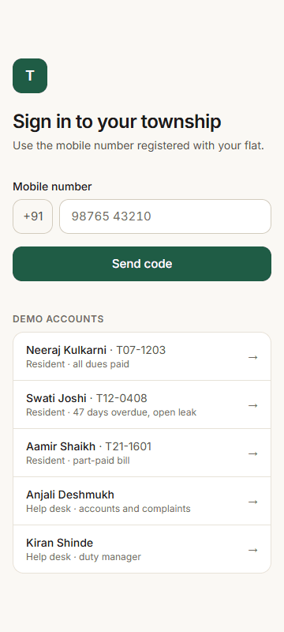 | 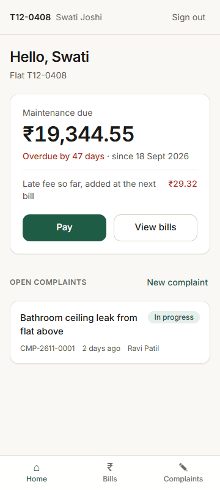 | 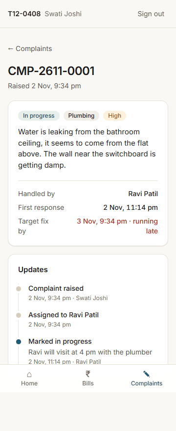 | 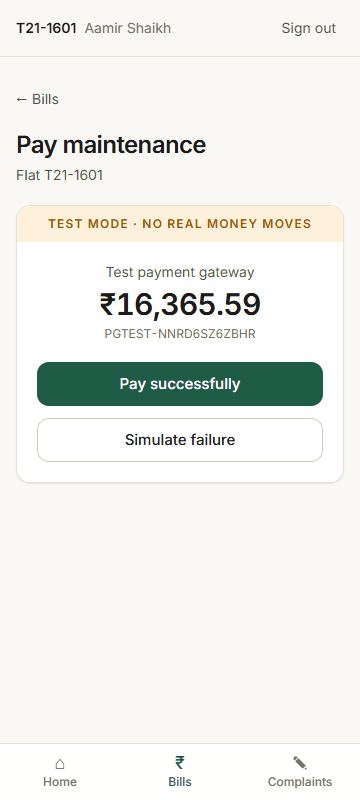 |

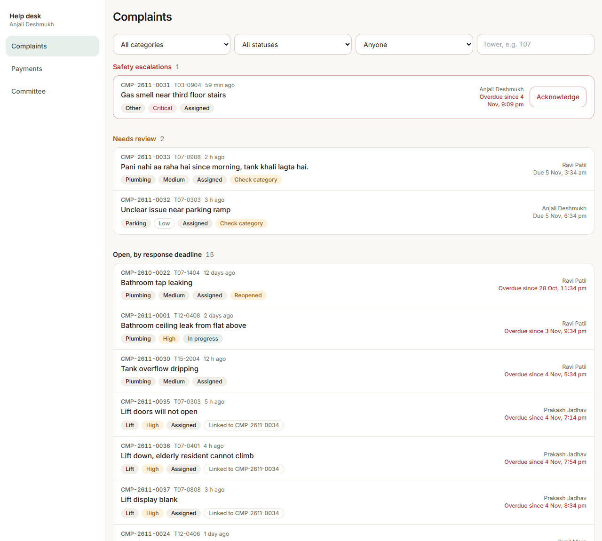

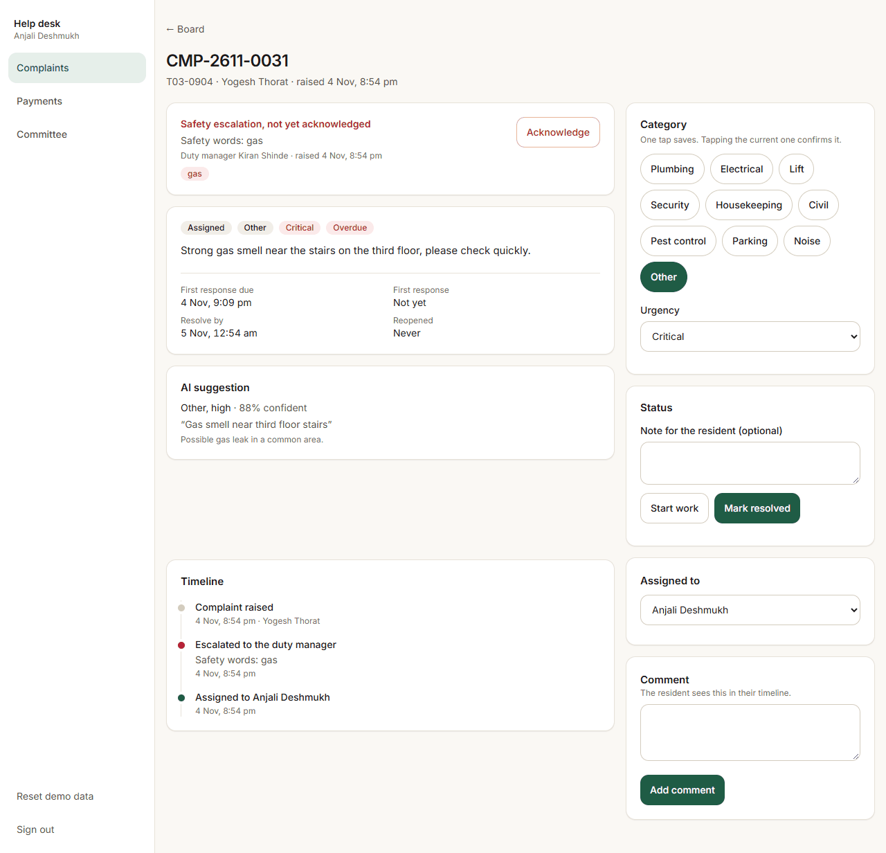

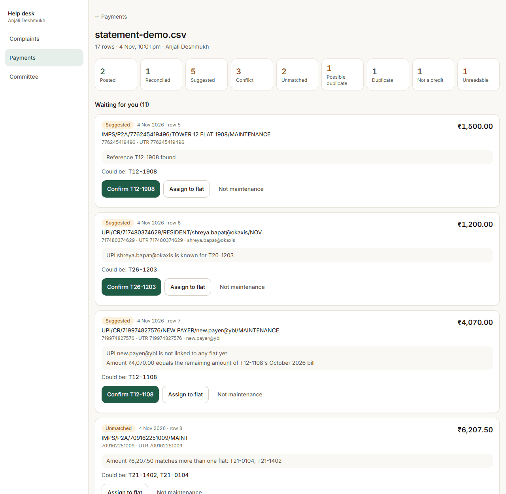

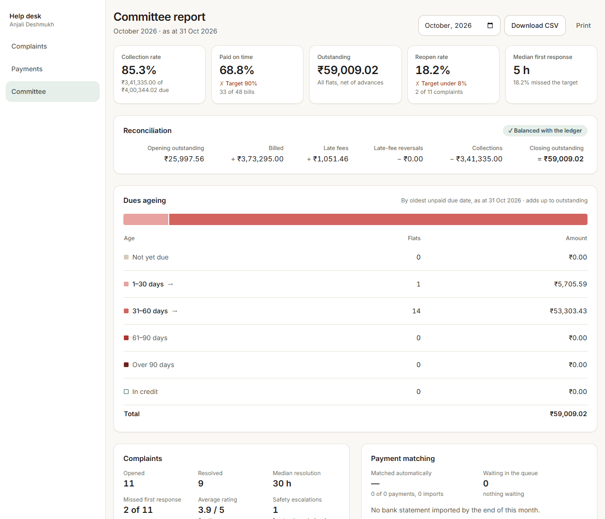

- **Calm and minimal:** a warm off-white canvas, near-black text and one deep-green accent for primary actions. **Red appears only for overdue money and safety; amber only for "needs review".** On any screen, colour means something.
- **The resident's home answers two questions in one glance:** "what do I owe?" (amount, days overdue in red, late fee so far, a Pay button) and "where is my complaint?" (status, who has it, linked and escalated badges). Every resident action is within two taps of home.
- **Mobile first, at 360 px:** bottom navigation for residents; a sidebar on desktop and tabs on a phone for the help desk. On a phone the desk's action cards come before the history. Every page was checked headlessly at 360 px and 1,280 px for horizontal scroll.
- **Trust in money:** tabular figures, right-aligned, with Indian grouping (₹1,23,456.00). A TEST MODE banner on the gateway. Receipts show exactly what a payment paid. The committee's reconciliation shows its own arithmetic and a "Balanced with the ledger" check.
- **The help desk works by exception:** the lanes put safety first, then what the AI was unsure of, then the next deadline. Category is a row of chips because correcting the AI should cost one tap. Queue cards show the matcher's reasons, because staff should see *why* before they confirm. Buttons lock on the first click so nothing posts twice.
- **Every screen has loading, empty and error states, and every form validates inline.** An app-wide error boundary replaces a blank screen with a reload card. Text meets WCAG AA contrast (the faint grey was darkened to 5.0:1 after a check); touch targets are at least 44 px; focus is always visible.
- **The ageing chart** is one hue that darkens with age (neutral for "not yet due"), with 2 px gaps, a hover tooltip and a table underneath that doubles as the legend and the accessible view. Each bucket drills into its flats.

---

## 9. Security

- Secrets only in environment variables; `.env` is ignored by git and never committed (the history was scanned). Tests generate their own secrets.
- httpOnly, Secure, SameSite=Lax session cookie; CSRF double-submit on every write; stateless JWT.
- Server-side role checks (`/api/desk/**` and `/api/committee/**` for help desk only) and a flat-membership check on every flat-scoped endpoint.
- Bean Validation on every request body; errors as RFC 7807 problem details with per-field messages; no stack traces in responses.
- Upload limits: 5 MB per file; CSV limited to 20,000 rows; photos checked by magic bytes, not by extension.
- Content-Security-Policy `default-src 'self'` (no inline script or style), X-Frame-Options DENY, nosniff, a strict referrer policy and a Permissions-Policy.
- OTPs stored only as hashes; OTPs, JWTs, keys and full phone numbers are never logged.
- The container runs as a non-root user. Demo-only endpoints (demo accounts, sample statement, data reset) do not exist unless demo mode is on.

---

## 10. Assumptions

Everything the brief does not state is an assumption, labelled with an ID and logged in the same commit that introduced it. Values marked *configurable* live in `society_settings` or `application.yml`. Decisions that change money or what users see were confirmed with the client contact (marked "Decided with Maniram").

| ID | Area | Assumption | Why |
|---|---|---|---|
| A1 | Billing | Bills are generated monthly for the calendar month, dated the 1st. | Brief says "₹ a month" and "first 10 days of a month". |
| A2 | Billing | Bill = area (sq ft) × rate, rounded to 2 decimals HALF_UP. Rate ₹6.50/sq ft/month, *configurable*. Area and rate are snapshotted on each bill. | Rate and formula given in the sample data; snapshot keeps old bills correct if the rate changes. |
| A3 | Billing | Due date is the 10th of the billing month, *configurable*. | "Most bills are paid in the first 10 days of a month." |
| A4 | Late fee | Simple interest on overdue principal at 21% per annum, counted per day after the due date, *configurable*. To be confirmed against the society's bye-laws. | Brief says late interest follows the bye-laws but gives no rate. 21% p.a. is a commonly used ceiling in Maharashtra model bye-laws; it must be checked with the client. |
| A5 | Late fee | Interest accrues daily and is shown live as "late fee so far". It is posted to the ledger as a charge in the next monthly billing run. Interest is not charged on interest. | Keeps the ledger append-only and predictable for the committee. |
| A6 | Payments | A payment is allocated to the oldest unpaid bill first, then to posted late-fee charges. Any excess becomes an advance (credit) on the flat's ledger and is used by the next bill. | Standard and easy for residents to understand. |
| A7 | Members | Bills belong to the flat, not a person. Every active member of the flat (owner, tenant, family) can see and pay the flat's bills and raise complaints for it. | Sample shows a tenant (Swati Joshi) as the resident of record. |
| A8 | Bank CSV | Statement format: one CSV per import with columns Txn Date, Description, Ref No, Debit, Credit, Balance. Header names are matched against common aliases. Dates dd/MM/yyyy or yyyy-MM-dd; amounts may use Indian grouping (1,23,456.00). Only credit rows are considered. Max 5 MB, 20,000 rows. | The brief gives no format; this mirrors common Indian bank exports. |
| A9 | Matching | A row is posted automatically only when the flat reference and a known UPI ID name the same flat, or when one of them is confirmed by an amount that is unique to that same flat. The amount is a supporting signal only: it never causes a conflict, and when it points elsewhere it is ignored with a reason. A conflict is only a reference and UPI ID naming different flats, or an ambiguous reference. One signal alone (reference, UPI ID, or a unique amount) makes a suggestion that a person must confirm; an amount matching several flats, even including the referenced one, is not agreement. Conflicting, single-signal and unmatched rows go to the accounts queue. | "Unclear payments go to an accounts queue and are never posted to a flat automatically." Amounts collide by chance (flats of equal area have equal bills), so they confirm but never override what the resident wrote. |
| A10 | Matching | A UPI ID becomes "known" for a flat when staff confirm a row carrying it. Seed data includes some known UPI IDs. | Lets matching improve over time without guessing. |
| A11 | Matching | Online test payments carry a gateway reference (PGTEST-…). When the same money appears in the bank statement it is reconciled to the existing payment, not posted again. | Prevents double-posting the same payment. |
| A12 | Roles | Two roles in the core build: RESIDENT and HELPDESK. Help desk staff also work the accounts queue and can open the committee view. One help-desk user is flagged as duty manager. | Brief's core roles are "resident and help-desk staff". |
| A13 | Complaints | Categories: Plumbing, Electrical, Lift, Security, Housekeeping, Civil, Pest control, Parking, Noise, Other. Urgency: Critical, High, Medium, Low. | Brief asks for category and urgency without listing them. |
| A14 | Complaints | Response targets (first response / resolution): Critical 15 min / 4 h; High 2 h / 24 h; Medium 8 h / 72 h; Low 24 h / 7 days, *configurable*. Clock runs 24×7. | Brief asks for a response timer but gives no targets. |
| A15 | Complaints | Status flow: Open → Assigned → In progress → Resolved → Closed. Only the resident closes (with a 1–5 rating) or reopens (with a reason) a resolved complaint. Reopen returns it to the same assignee. | Reopen rate is a success metric, so reopening must be explicit and counted. |
| A16 | Complaints | Auto-assignment: the staff member whose skills include the category and who has the fewest open complaints; otherwise the general help desk. | Brief asks for auto-assignment without a rule. |
| A17 | Safety | Safety terms (configurable list, English/Hindi/Marathi): fire, smoke, burning smell, gas, gas leak, LPG, cylinder, lift stuck, stuck in lift, trapped, shock, electric shock, current, sparking, short circuit, electrocution, and their Hindi/Marathi equivalents. Matching is case-insensitive on word boundaries. Negations ("no fire") still escalate. | Brief names fire, gas, lift stuck and shock. A false alarm is cheaper than a missed emergency. |
| A18 | AI | Only the complaint text is sent to the AI: no name, phone or flat number. Classification runs in the background so a resident never waits: on raise the safety rule (and its escalation) and the keyword classifier run at once and the complaint is saved as "sorting" (`classification_status = PENDING`); after the save commits, the AI is asked with a 20 s timeout and one retry after 2 s (*configurable*: `app.gemini.timeout`, `app.gemini.retry-delay`). An AI answer replaces the keyword category, urgency and due times only if no staff member has acted yet; otherwise the staff values stay and the answer is recorded as an `AI_SUGGESTED` event (an AI Critical still escalates, A33). AI confidence below 0.6, a failure after the retry, or no answer within 2 minutes (`app.classification.give-up-after`) keeps the keyword result and sends the complaint to the "needs review" lane. The free Gemini tier is for the demo only; production must use the paid tier, whose rate limits and latency suit a live help desk and whose data terms do not allow prompts to be used for training. | DPDP data minimisation, the brief's "what happens when it is wrong", and a free-tier model that sometimes takes longer than a resident should wait. |
| A19 | Duplicates | A new complaint is linked to an earlier open complaint from another flat in the same tower and category within 72 hours when the texts are similar. Lift complaints in the same tower within 24 hours are linked on tower and category alone. Help desk can unlink. | "Ten flats reporting the same lift." |
| A20 | Messages | SMS and WhatsApp are mocked: messages are written to an outbox table and shown in the app. In demo mode the login OTP is shown on screen. | Brief says to mock messages. |
| A21 | Data | All seed names and phone numbers are fictional. | Brief: no real personal data in the repository. |
| A22 | Late fee | The billing run for month M posts late interest accrued up to the last day of month M−1, so a run depends only on its month and rerunning it never posts twice. Interest after that day is shown live as "late fee so far" and posted by the next run. Months after the current month cannot be billed. | Makes A5 precise and keeps the run idempotent on any day it is triggered. |
| A23 | Payments | An online payment may be at most ₹1,00,000 above what the flat owes, *configurable* (`app.payments.max-amount-above-outstanding`). Larger amounts are refused with a clear message. | A sanity cap against typing mistakes; overpayment within the cap becomes advance (A6). |
| A24 | Late fee | Interest for a day is charged on the principal still unpaid at the end of that day, so a payment stops interest from the day it is made. Interest is rounded to paise once per bill per charge period. | Makes "per day" in A4 exact when a bill is part-paid. |
| A25 | Demo data | Seed history is relative to the seed date. Swati (T12-0408) has paid nothing; her oldest bill is due exactly 47 days before the seed date. Aamir (T21-1601) has paid all earlier bills; his latest bill that has fallen due is ₹10,660 with ₹5,000 paid and is due exactly 18 days before; the current month's bill is issued but not yet due. Neeraj (T07-1203) owes nothing. Other flats are given a paying habit by quota: 70% on time, 15% late, 10% partial, 5% not paying. | Brief sample table and the 70% on-time baseline; oldest-first allocation (A6) means a resident cannot have paid later bills while an older one is open. |
| A26 | Demo data | Seeded payments use realistic channels: online test payments with a succeeded gateway intent, UPI and bank transfers with a 12-digit UTR (as if matched from a bank statement), and a few cheques entered manually. | Gives the bank-matching and reconciliation steps real references to work with. |
| A27 | Bank CSV | Required columns: date, description and credit; reference and debit are optional and extra columns (Balance, Value Date, Sl No) are ignored. The UTR is the first 12-digit number in the reference, then in the description, otherwise the reference itself; a gateway reference is never used as a UTR. Errors name the spreadsheet row (blank lines count; a quoted cell spanning lines counts once). | Statements differ between banks; these rules accept the common exports without guessing at amounts. |
| A28 | Matching | A bank row whose UTR (or gateway reference) was already posted, reconciled or seen earlier in the same import is a `DUPLICATE`: not posted and not queued. A row with no UTR whose row hash (date, description, reference, amount) equals an earlier bank row is a `POSSIBLE_DUPLICATE`: it is linked to that row, goes to the accounts queue and is never posted automatically, because two genuine identical cash deposits on one day are possible. | Re-importing a statement must never double-post (rule 8), but money without a transaction ID should not be thrown away either. |
| A29 | Matching | A row that would be auto-posted is held as `SUGGESTED` instead when its amount is more than the flat's total outstanding plus one month's bill for that flat (*configurable*: `society_settings.auto_post_limit_months`, default 1). The reason names the dues, e.g. "Amount ₹70,000.00 is much higher than T21-1601's dues of ₹16,368.85; check before posting". | Agreeing signals prove whose money it is, not that the amount is right; a typo or a corpus contribution should be looked at by a person before it becomes a large advance. |
| A30 | Matching | A bank row that would be auto-posted but is dated after today is held as `SUGGESTED` ("Dated after today; check the statement before posting"). Rows posted from a statement use method UPI when the row carries a UPI ID, otherwise bank transfer; the bank's UTR or reference is stored on the payment, and the transaction date is the payment date. | A statement should never contain future dates; holding the row keeps one bad date from failing the whole import. |
| A31 | Demo data | The demo bank statement is generated from current data with one row per decision type. Its references are derived from the date and the number of imports so far, so downloading twice before uploading gives the same file (re-uploading it only produces duplicates), and every new import makes the next download fresh. | Lets a reviewer see every decision on any date without ever double-posting. |
| A32 | Complaints | Refines A15/A16. Auto-assignment goes to a specialist first (staff whose skills include the category, fewest open complaints, then longest serving); the general desk (staff with every skill) takes only categories no specialist covers. An auto-assigned complaint starts as Assigned; auto-assignment is not a first response — the first staff status change, comment or reassignment is. Staff may move Open → Assigned or In progress, Assigned → In progress or Resolved, In progress → Resolved; only the resident closes (rating 1–5 required) or reopens (reason required) a Resolved complaint, and Closed is final. A reopen returns it to Assigned with the same assignee and restarts the resolution clock from the reopen time. | Keeps specialists on their own work, makes the response timer measure people, and gives a reopened complaint a fair new deadline. |
| A33 | Safety | The safety words (A17) live in `application.yml` (`app.safety.terms`) and can be changed without code. They match whole words, ignoring case, in English, Hindi, Marathi and romanised Hinglish. Each word form is listed explicitly (आग, आगीत, आगीचा, आगीमुळे; धूर, धुराचा; गॅस, गॅसचा), so a common word that merely starts the same way never matches: आगे ("ahead"), धुआंधार ("heavy"), धूर्त, sparkling, fireplace, gasket. A trailing `*` (any ending) is used only after a word that already pins the meaning, e.g. `लिफ्ट में फंस*`, `हम फंस*`, `current lag*`. Words that are ambiguous alone are listed only in an unambiguous phrase: "current" ("current month bill") as "getting current", "current from", "current lag…"; फंस/अडक ("पैसे फंसे हैं", payment stuck) only after लिफ्ट, हम or मैं, or in a first-person form (फंस गया हूं, अडकलो); झटका/jhatka ("a setback") only as करंट का झटका, बिजली का झटका; a lift stop only as "lift atak gayi". Some real emergencies worded unusually may therefore not be caught by the rule; the AI can still rate them Critical and the help desk can raise urgency in one tap. If the AI rates a complaint Critical and no safety word matched, it is escalated to the duty manager too, with the reason "AI rated critical: <the AI's reason>" (keyword-fallback ratings never escalate on their own). The AI can add an escalation but never remove one or lower the urgency the rule set. `samples/complaints-eval.csv` holds look-alike non-emergencies that must never escalate. | A false alarm on everyday words (आगे is in many complaints) would train staff to ignore the safety lane; a missed gas leak costs far more than an occasional false alarm, so every form of the brief's four hazards stays listed. |
| A34 | Complaints | The help desk can change category and urgency in one tap on any complaint that is not closed. The change is recorded as `CATEGORY_CHANGED` (from and to, e.g. `OTHER/MEDIUM` → `PLUMBING/HIGH`), clears "needs review" and counts as the first response; choosing the same values confirms the AI's answer. A new urgency moves both due times: first response from the time raised, resolution keeping its clock start (raised or last reopened). A new category hands an active complaint to auto-assignment (A32) only if the current owner is not suitable for it. A complaint with safety words stays Critical: lowering it is refused. A complaint escalated only because the AI rated it Critical may be lowered by the help desk, since that is a human correction; its escalation stays and still has to be acknowledged. The Safety lane lists every escalated complaint. Recategorising while the AI is still sorting the complaint makes the staff choice final: the late AI answer is recorded but does not override it (A18). Any help-desk staff member can acknowledge a safety escalation, once; who and when are recorded and it counts as the first response. | Keeps the rule-based safety escalation (rule 2) beyond correction, and makes every correction visible for the AI-accuracy measure. |
| A35 | Duplicates | Refines A19. Texts are "similar" when the share of words they have in common (Jaccard similarity of their word sets, after lowercasing, dropping punctuation and a short list of filler words in English, Hinglish, Hindi and Marathi) is at least 0.35. The earlier complaint may be in any state except Closed (a Resolved one still counts, since the same fault is being reported again). A new complaint always links to the root of a group, never to another child, so there are no chains. The check runs when a complaint is raised (on its keyword category), again when the AI answer changes the category, and after a help-desk recategorise; a linked complaint whose category no longer matches its group is unlinked automatically and checked again. Once the help desk unlinks a complaint it is never linked automatically again. A status change reaches linked complaints only when the help desk ticks "apply to linked"; each linked complaint gets its own event ("Applied from CMP-…") and one that cannot make that move is left as it is; the response lists the complaints updated and each one skipped with its status and the reason ("Already resolved.", "Cannot move from resolved to in progress."). Residents see the group's first reference and how many flats reported it, never the other flats. Windows and threshold are *configurable* (`app.duplicates.lift-window` 24 h, `text-window` 72 h, `minimum-similarity` 0.35). | Simple, explainable and language-neutral; one root per group keeps "n flats reported this" a single count. |
| A36 | Committee | Decided with Maniram. A month is a calendar month in Asia/Kolkata, reported "as at" its last day, or today for the current month. Money figures come from the ledger by entry date: billed, late fees charged, late-fee reversals (from back-dated payments, their own line) and collections (by payment date); a payment posted later but dated inside a past month changes that month, and a month's late interest appears once the next billing run posts it (A22). Reconciliation: opening outstanding + billed + late fees − late-fee reversals − collections = closing outstanding. **Collection rate** = collections ÷ (opening outstanding + billed + late fees − reversals). **On-time rate** = bills due in the month (up to yesterday) fully paid by their due date ÷ those bills, target 90%. **Dues ageing** places each flat's ledger balance by its oldest unpaid due date (an unpaid late fee ages from its bill's due date): not yet due, 1–30, 31–60, 61–90, over 90 days; flats with an advance form an "In credit" line with a negative amount, so the lines add up to closing outstanding. **Auto-post share** = auto-posted rows ÷ rows that brought new money (auto-posted, suggested, conflict, unmatched, possible duplicate) in the month's imports; reconciled gateway payments, duplicates and debits are left out. Complaints: opened, median first response and first-response breaches use complaints raised in the month (a breach is a late response or no response after the target has passed; ones still within target are not counted); resolved and median resolution (raised to resolved) use complaints resolved in the month; **reopen rate** = complaints raised in the month that were reopened at least once ÷ complaints raised in the month, target under 8%; average rating uses complaints closed in the month. Linked complaints count separately (each is a resident's own complaint). Queue size, oldest queued row, open complaints by category and safety escalations are live figures, shown as of now for any month. Targets are *configurable* (`app.committee.on-time-target`, `reopen-target`). | The brief asks for a monthly report the committee can trust and names the 70%→90% and 25%→under 8% targets without defining the measures. |

---

## 11. What was cut, and what is next

**Cut on purpose** (core first, per the brief's "build a small part really well"):
- **Visitors and gate guards, amenity booking, Hindi/Marathi UI, an installable app, notices and member management.** All are in the plan as optional steps; none has a button in the app.
- **Real SMS, a real payment gateway and Tally export.** These are mocked, as the brief allows.

**Next, in order:**
1. **Auto-close unrated complaints:** close resolved complaints the resident has not confirmed after N days (for example 7), recorded as "closed without rating", so they do not sit in "awaiting resident" forever and do not distort the reopen rate.
2. **Split the accounts and committee roles from HELPDESK:** today every help-desk user can work the accounts queue and see the committee report. Separate ACCOUNTS and COMMITTEE roles would follow least privilege.
3. **Re-apply overpaid late fees:** when a back-dated payment reduces a late fee that was already paid, the overpaid part shows as ledger credit but is not yet re-applied to the next bill as advance.
4. **A rate limit per IP:** sign-in is limited per phone number and per code; add a per-IP limit (for example at the edge or with a token bucket) against number-spraying.
5. **The paid Gemini tier** for production: rate limits and latency suited to a live help desk, and data terms that exclude training on prompts.
6. Then the optional features above, starting with visitors (the brief's third pillar) and Hindi/Marathi for the resident screens.

---

## 12. Honest limits

- **Demo scale:** the seed has 48 flats in 6 towers, not 2,400 in 28. The matcher is benchmarked at 3,000 rows against 2,400 flats (about 0.5 s); the committee queries were not load-tested at full scale.
- **Past months can move:** a payment dated in a past month but imported later, or the next billing run's late interest, changes that month's figures. The report says "as at" and explains this.
- **Gateway confirmation is browser-driven in test mode.** A real gateway would confirm with a signed server-to-server callback.
- **The AI evaluation is small** (35 complaints) and the free tier's latency varies. Urgency agreement with the labels is 63%, though every miss leans towards caution. The safety rule cannot catch every unusual wording of an emergency; the AI and the help desk are the second and third lines.
- **Late-fee rate (21% p.a.) and the response targets are assumptions** to confirm against the society's bye-laws and the facility contract.
- **A resident with several flats sees the first one;** there is no flat switcher yet.
- **Free hosting:** a cold start of about a minute after 15 minutes idle; the free Neon database pauses when idle.
- **The UI was checked in headless Chrome at two widths,** not on physical Android or iOS devices.

---

## 13. How I used AI

I used AI a lot on this project, which the brief encourages. But I want to be clear about which parts were mine.

I started by asking Claude to help me compare the five briefs. I went with the township app because I'd built something similar before (Gatify, a gated community product), so I already understood how residents, help desks and committees actually work. Before writing any code, I turned the brief into a written plan: the build steps in order, a list of every assumption I had to make, and a set of rules the coding agent had to follow. For example, money is always exact (BigDecimal, never double), the ledger is never edited, no secrets go in the repo, and every rule the brief calls non-negotiable needs a test.

Claude Code wrote most of the code, one step at a time. After each step I read what it built, checked it against the brief, and only then let it move on. Each commit had to build and pass all tests before it was pushed.

Some of the decisions that shaped the product:

- Late interest at 21% a year. The brief doesn't give a rate, so this is a placeholder to confirm against the society's bye-laws. It's a setting, not code.
- A bank payment is only posted automatically when two separate clues agree on the flat (the flat reference, a known UPI ID, or an amount only one flat owes). The amount on its own is a weak clue, because many flats owe the same amount, so it can support a match but never block one.
- If the same row appears twice without a bank reference, I send it to the accounts queue instead of skipping it, because two people can genuinely pay the same amount on the same day. Very large amounts are also held for a person to check.
- When I reviewed the safety words, I found that a wildcard on आग ("fire") also matched आगे ("ahead"), one of the most common Hindi words. I replaced the wildcards with explicit word forms, and added everyday sentences that must never raise an alarm. I also made an AI "Critical" rating alert the duty manager, so the word list isn't the only safety net.
- The first live AI test showed 5 of 35 complaints timing out. Instead of making residents wait longer, I moved the AI into the background. The safety check still runs instantly, and the AI fills in the category a few seconds later.
- Demo data goes stale as late fees build up every day, so I added a demo reset and a sample bank statement that's generated from the current data.

I checked the important numbers myself: Swati's late fee of ₹172.25, the reconciliation totals, and the matching results on the sample statement. I also ran the live Gemini test (97% category accuracy, no missed emergencies, no false alarms) and clicked through the deployed app.

Inside the product, AI only does one job: suggesting a complaint's category and urgency. Every rupee is calculated by fixed, tested rules. The AI can't post a payment, close a complaint, or lower a safety escalation.